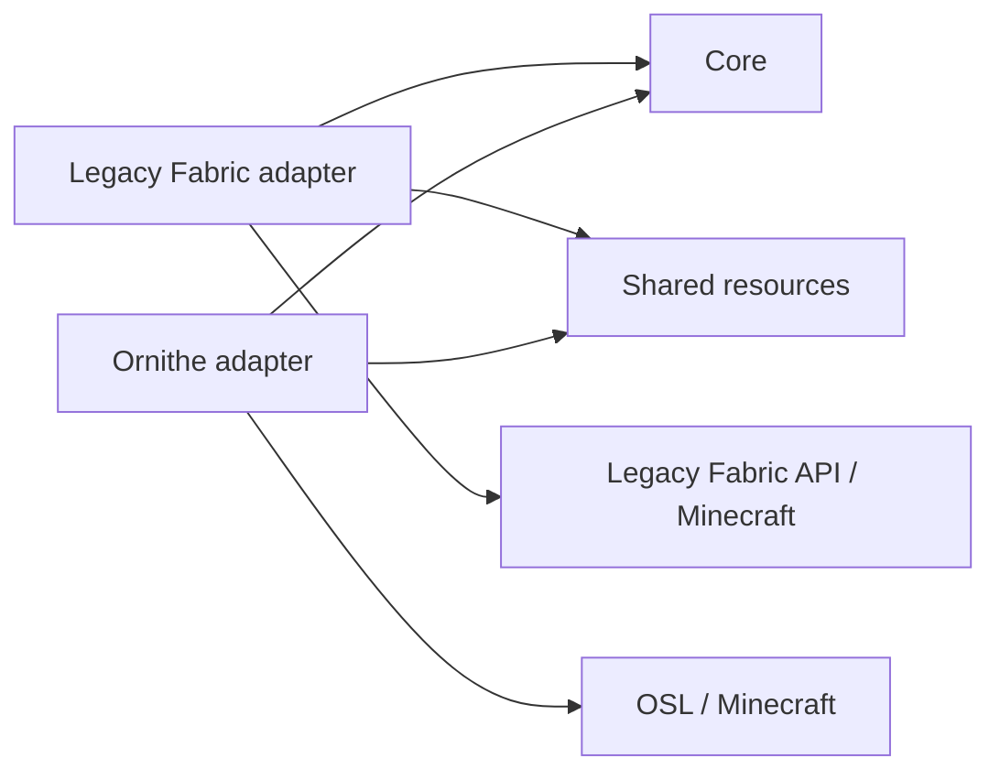

# Architecture

The build has four projects and a small included `build-logic` build. It produces two
independent client mods for Minecraft 1.8.9. The adapters use different mappings and
intermediary namespaces; each distribution contains the same core classes and assets.

## Architecture

The domain is visibility state. `VisibilityController` implements the toggle use case
and exposes a read-only `VisibilityView`. `ClientEffects` is the boundary for world
availability and translated feedback. The adapters implement
that boundary with their respective Minecraft and platform APIs.

## Modules

| Project | Contents | Production dependencies |
| --- | --- | --- |
| `core` | Visibility controller, interfaces and translucent ordering | Java standard library |
| `shared-resources` | Nine translations, icon, barrier models and texture | None |
| `legacy-fabric` | Client entrypoint, chunk indexes, rendering adapters, Mixins, metadata | Core, resources, Legacy Fabric API, Fabric Loader, Minecraft |
| `ornithe` | Client entrypoint, chunk indexes, rendering adapters, Mixins, metadata | Core, resources, OSL modules, Fabric Loader, Minecraft |

`shared-resources` exposes a resource archive through a consumable Gradle configuration.
Adapters consume it through project dependencies. Core classes are embedded directly
in each adapter JAR before remapping. Neither the core archive nor the resource archive
is installed separately. Each adapter exposes its `remapJar` output for distribution
verification and staging.

Build conventions configure Java 8 compilation, Java 8 tests, reproducible archive
ordering, and adapter packaging. Loader plugins apply only to adapter projects. The
root build aggregates checks and distributions; it contains no mod sources.

Committed daemon JVM criteria select JDK 21 for both command-line and IDE builds.
Each settings build configures toolchain provisioning, so the included build can resolve
its compiler independently and the main build can provision the Java 8 test runtime.

## Boundaries

Core production compilation and runtime classpaths contain no external dependencies.
It imports no Minecraft, Mixin, loader, or logging APIs. Tests may use JUnit. Artifact
verification also checks the core bytecode for non-JDK type references.

Mixins delegate chunk data changes to `BarrierPositions` and the translucent frame hook
to `BarrierRenderer`. The block Mixin supplies adjacent-face culling and the translucent
layer declaration. The particle Mixin suppresses barrier particles while visible. The
model Mixin enables the barrier block model. Input handling and visibility transitions
remain outside Mixins.

### Rendering in Minecraft 1.8.9

Minecraft compiles terrain into chunk meshes. `WorldRenderer.reload()` discards the
render chunk storage; marking sections dirty rebuilds their terrain geometry. Barrier
blocks retain vanilla render type `-1` in both visibility states, keeping their geometry
out of those meshes. Toggling changes a flag read by the separate barrier pass.

| Hook | Legacy Yarn build 568 | Feather build 28 |
| --- | --- | --- |
| Main camera pass | `GameRenderer.renderWorld(int, float, long)` around the translucent `WorldRenderer.renderLayer(...)` call | `GameRenderer.render(int, float, long)` around the translucent `WorldRenderer.render(...)` call |
| Terrain submission | `AbstractChunkRenderManager.render(RenderLayer)` in `WorldRenderer` | `RenderChunkList.render(BlockLayer)` in `WorldRenderer` |
| Compiled translucent vertices | `ChunkAssemblyHelper.setDrawArrayParameters(...)` | `CompiledChunk.setTransparencyState(...)` |
| Successful block change | `Chunk.getBlockState(BlockPos, BlockState)` | `WorldChunk.setBlockState(BlockPos, BlockState)` |
| Chunk packet applied | `Chunk.method_3895(byte[], int, boolean)` | `WorldChunk.update(byte[], int, boolean)` |
| Section replacement | `Chunk.setLevelChunkSections(ChunkSection[])` | `WorldChunk.setSections(WorldChunkSection[])` |

Each chunk owns its barrier positions. Block changes update individual entries; bulk
data changes rebuild that chunk's index from its nonempty sections. The renderer reads
only the current world's loaded chunk indexes within render distance and culls positions
against the camera frustum. Client chunk lookups return an empty chunk for unloaded data.
Unloading or replacing a chunk therefore removes its barriers from subsequent frames.
Index reads and client-side mutations reject calls outside Minecraft's client thread.
The read-only position view is live and must be consumed on that thread; it is not a
snapshot for worker rendering. The index retains neither its chunk nor its world.

The pass submits only barrier models to Minecraft's block model renderer. It uses a
reusable vertex buffer, camera-relative coordinates, current world lighting, and the
current baked models. Adjacent barrier faces are culled across chunk boundaries.
`TranslucentOrder` merges barrier and terrain quad centres into a stable far-to-near
order and coalesces contiguous source ranges. It operates on numbers and range callbacks;
Minecraft vertex formats and draw operations remain in the adapters. Opaque terrain
occludes barriers through depth testing.

Each compiled chunk publishes its translucent vertex snapshot through a volatile
reference. The client thread copies a new snapshot into a cached `TranslucentBatch`.
The snapshot retains the builder's world origin before the worker reuses that builder,
including OptiFine's region origins. Each range uses its original vertex format and
the appropriate chunk transform. Cached batches live with their compiled chunks and
are replaced when the snapshot changes. They own no GPU buffers.

When visible barrier geometry exists, the terrain submission hook replaces the native
translucent container draw with the shared order. Every selected terrain quad is
submitted once, using its existing vertices; no non-barrier model is tessellated by LVB.
Hidden barriers and views without barrier geometry retain the native submission path.
Opaque terrain submission is unchanged. Sorting visible translucent vertices adds
per-frame CPU work while the shared path is active.

The frame hook selects the translucent invocation by its layer field, without capturing
locals. The caller brackets the layer call, and a redirect owns only its native terrain
container submission. Both caller hooks require exactly one matching site. If a mod
cancels the layer call, the caller still submits barriers once afterwards. Sharing
order with a replacement renderer requires that renderer to retain the native compiled
chunk submission path. Each anaglyph eye has its own pass. Shadow passes are excluded.

The pass inherits the atlas, blending, fog, depth mask, shader program, and camera
matrices. `BarrierRenderState` selects VAO 0 before saving client vertex arrays and
buffer bindings, unbinds any VBO for Minecraft's CPU-buffer uploader, and restores that
state before reselecting the incoming VAO. Core or ARB entry points are selected from
the current context's capabilities; contexts without VAOs retain the original path.
Foreign VAO attributes and element buffers remain untouched. The guard also
preserves the atlas and lightmap textures, enable state and texture matrix, active texture units,
matrix mode, and current attributes. Restoration uses `GlStateManager` for its cached
state, including explicit color-cache reconciliation. It neither clears the framebuffer
nor requests terrain invalidation. The shared path uses Minecraft's CPU uploader with
either VBO or display-list terrain enabled. OptiFine's uploader retains shader attributes
and quad-to-triangle conversion. Its multi-texture path is limited to the selected range
and uses the translucent layer's sprite order. Atlas restoration also restores the raw
GL binding because OptiFine's sprite uploader bypasses Minecraft's binding cache.

The renderer requires the client thread and rejects reentrant submission. Model or
upload failures propagate to the caller. The renderer discards its failed CPU batch,
so the next invocation starts with a fresh builder. Upload-state restoration runs in
`finally`, including when lightmap setup fails. Models and GPU resources are not cached
across resource reloads or world replacement.

Ordering follows Minecraft's quad-centre distance rule, including its transparency
limitations for intersecting custom geometry.
Renderer-specific scope and tested combinations are in [compatibility.md](compatibility.md).

## Contracts

The controller is constructed on the client thread, which exclusively owns mutation
and client effects. `toggle()` rejects calls from another thread before touching the
client boundary. A volatile visibility field permits reads from other threads; index
access and Minecraft rendering remain confined to the client thread.
State changes precede feedback. The controller has no renderer invalidation operation.

Each adapter registers its callbacks once. Its safely published read-only view returns
hidden before initialization. The tick callback consumes every queued key press;
presses without both a world and a player are discarded. There is no pending action to
replay on the next connection.

Visibility survives disconnects, world changes, and resource reloads within a client
process. A new client process starts hidden. There is no persistent configuration or
server-side state.

Chunk indexes and barrier drawing belong to the client thread. Vanilla packet handling
applies chunk and block updates on that thread, so rendering sees complete updates.
The index contains immutable position copies and lives with its chunk. Rendering obtains
baked models on each pass, allowing resource reloads to replace models without retaining
stale references. Visibility changes perform no world mutation, chunk rebuild, terrain
reload, or non-barrier model submission.

Core tests cover state transitions, feedback, thread ownership and draw ordering. Client smoke tests
compare water/glass overlap with a shared reference batch and verify barrier-only pixel
changes, compiled terrain submission, frame hooks, lifecycle updates and
restoration of changed graphics state. Optional mod fixtures exercise enabled rendering
features. Artifact checks enforce module isolation, metadata, assets, Java 8 bytecode
and exclusion of test classes.

Public guarantees and versioning policy are defined in [compatibility.md](compatibility.md).
The Java types are internal implementation interfaces, not a separately published API.
