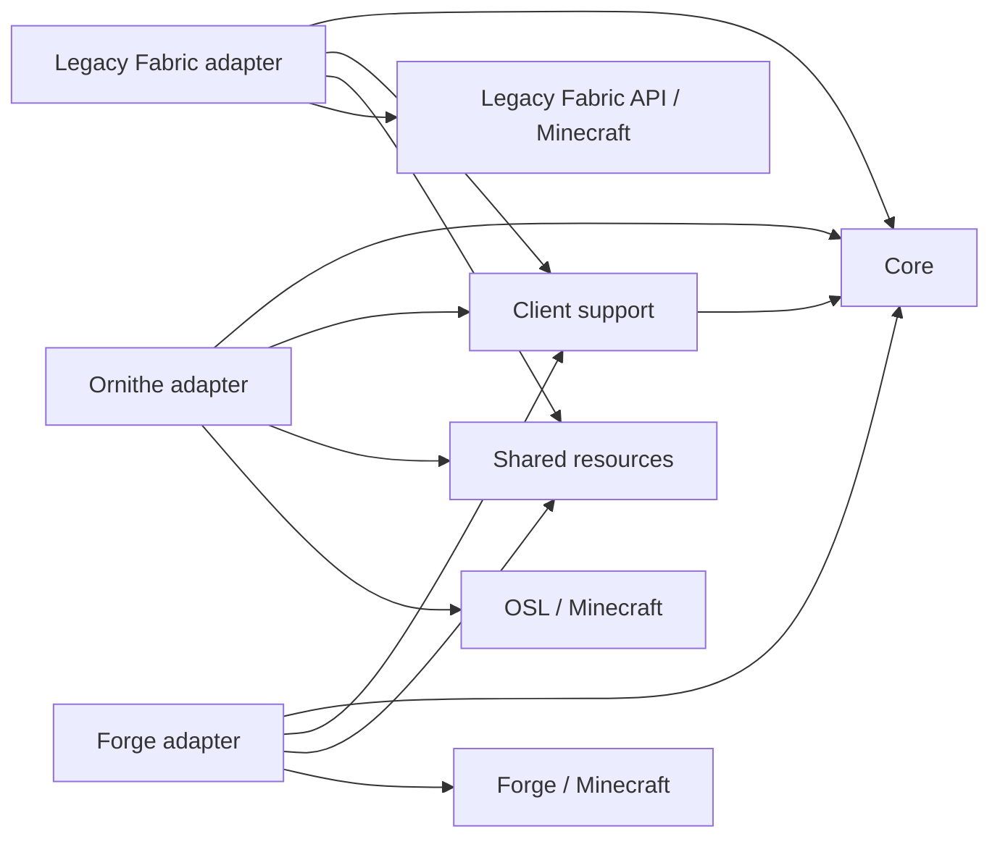

# Architecture

The build separates the Java domain, shared client persistence, resources and mapped
loader adapters. Legacy Fabric and both Ornithe generations use the root multi-project
build. Forge uses an included build with its own Loom plugin classpath. The four
installable distributions embed the same core, persistence classes and assets.

## Architecture

The domain is visibility intent and effective rendering availability. `VisibilityController` implements the toggle use case
and exposes a read-only `VisibilityView`. `ClientEffects` is the boundary for world
availability and translated feedback. The adapters implement
that boundary with their respective Minecraft and platform APIs. `RenderingPolicy`
publishes one immutable snapshot containing the mode, requested visibility and latched failure reason. Client decisions remain private until the tick finishes, so workers never observe
intermediate cancelling toggles. The policy owns monotonic failure transitions and
coalesces native geometry refresh decisions.

## Modules

| Project | Contents | Production dependencies |
| --- | --- | --- |
| `core` | Visibility, rendering policy, preferences, edit drafts and translucent ordering | Java standard library |
| `client-support` | Atomic settings persistence, conflict detection and repair | Core, Java standard library |
| `shared-resources` | Nine translations, icon, barrier models and texture | None |
| `legacy-fabric` | Client entrypoint, settings screen, rendering adapters, Mixins, metadata | Core, client support, resources, Legacy Fabric API, Fabric Loader, Minecraft |
| `ornithe` | Shared bootstrap, vertex-origin contract and test helpers | Core, client support; compile-only Fabric Loader, Mixin, ASM and logging APIs |
| `ornithe:gen1`, `ornithe:gen2` | Client entrypoints, settings screens, rendering adapters, Mixins, metadata | Core, client support, shared Ornithe classes, resources, generation-specific OSL and Minecraft |
| `forge` (included build `lvb-forge`) | Forge lifecycle, settings factory, MCP rendering adapters, Mixins and metadata | Core, client support, resources, Forge, Minecraft; embedded Mixin runtime |

`shared-resources` exposes a resource archive through a consumable Gradle configuration.
Adapters consume it through project dependencies. Core and client-support classes are embedded directly
in each adapter JAR before remapping. These shared archives are not installed separately. Each adapter exposes its `remapJar` output for distribution
verification and staging.
The shared Ornithe classes are embedded in both Ornithe distributions. Its test fixtures
are embedded only in the smoke-test JARs. Adapter metadata templates live in
`ornithe/resources`; both generations expand them during resource processing.

Build conventions configure Java 8 compilation, Java 8 tests, reproducible archive
ordering, and adapter packaging. Loader plugins apply only to adapter projects. The
root build aggregates checks and distributions; it contains no mod sources.

Essential Loom 1.15.51 and Fabric Loom share implementation package names. The Forge
included build isolates their plugin classloaders while retaining Gradle 9.2.1, JDK 21
and Java 8 output. Composite dependencies consume core, client support and resources
from their existing projects; no source directory is owned by two projects. Forge
remaps MCP stable 22 names to SRG. Its production launcher fixture uses Forge 2318's
published library list and the original Minecraft client. Development tasks explicitly
start the Mixin tweaker and use the same filtered Java 8 provider. They stage classes
and resources into one FML mod directory so language domains are discovered without
overlapping compiler and resource-task outputs.

The Forge JAR embeds the LaunchWrapper runtime from upstream Mixin 0.8.7 and its MIT
license. Its manifest registers the tweaker and configuration before Minecraft loads.
No Essential mod or runtime download is required. Forge Mixins contain no lambdas or
method references: copying those instructions requires ASM methods absent from Forge's
ASM 5.0.3. Ordinary Java 8 adapter classes own such callbacks. The artifact verifier
checks this boundary and excludes newer ModLauncher classes from the distribution.

Committed daemon JVM criteria select JDK 21 for both command-line and IDE builds.
Each settings build configures toolchain provisioning, so the included build can resolve
its compiler independently and the main build can provision the Java 8 test runtime.

### Mapping targets

`gradle/targets.json` defines each distribution's Gradle project, mapping generation,
dependencies, output directory and bootstrap sentinels. A single build compiles all
four targets. Ornithe outputs live in `ornithe/gen1/build` and `ornithe/gen2/build`.

Both Ornithe generations have independent Loom projects, source roots, Minecraft
classpaths, OSL dependencies, run directories and refmaps. IntelliJ imports both at once.
Minecraft-facing classes belong to their generation even where the mapped Java spelling
is identical. Shared Ornithe classes and test helpers have no Minecraft dependency and
are compiled once in the parent project. Each physical Java source root has one IDE owner.
Each target compiles and remaps against its own Feather and Calamus artifacts.
Core logic, client support and shared resources are generation-independent.
`gradle/runtime-profiles.json` pins Quilt's launcher libraries. Quilt uses the same
Ornithe distribution and generation-specific APIs; it does not introduce another
mapped source project or artifact.
Production client fixtures use published intermediary JARs, preserving the generation
manifest read by mapping translators such as Flap.

Before selecting rendering hooks, the Fabric-compatible `RenderingPlugin` uses the loader's public
mapping resolver to check two official-to-intermediary class identities against the
packaged target metadata. This works in named development and intermediary production
launches without loading Minecraft classes. A mismatch aborts bootstrap with the
required environment in the diagnostic. Rendering fallback applies only inside a
compatible mapping environment; it cannot translate binary class identities.

## Boundaries

Core production compilation and runtime classpaths contain no external dependencies.
It imports no Minecraft, Mixin, loader, or logging APIs. Tests may use JUnit. Artifact
verification also checks the core bytecode for non-JDK type references.

Mixins delegate chunk data changes to `BarrierPositions` and the translucent frame hook
to `BarrierRenderer`. The block Mixin supplies adjacent-face culling and the translucent
layer declaration. The particle Mixin suppresses barrier particles while visible. The
model Mixin enables the barrier block model. Input handling and visibility transitions
remain outside Mixins. `RenderingPlugin` selects an immutable startup hook profile
without loading Minecraft classes. `RenderingCoordinator` applies runtime decisions
and native invalidation on the client thread.

### Settings and optional UI integration

`RenderingPreferences` validates the two startup settings and resolves JVM overrides
before file values. `SettingsDraft` owns edits and dirty/reset behavior. Both are pure
Java core types. `client-support` owns UTF-8 properties parsing and atomic writes through `SettingsFile`.
It has no loader or Minecraft dependency.

Each mapping target owns a native `SettingsScreen`. A fresh screen holds a saved
snapshot and an independent draft, retained through resize and Controls navigation.
It reads immutable runtime status but has no operation that changes the active policy.
Saving cannot clear recovery, install omitted Mixins, toggle visibility or refresh
terrain. Preferences take effect on the next process start.

A single asynchronous save writes an immutable draft to a sibling temporary file.
Completion is observed on the client tick; widgets and screen transitions stay on
that thread. A save checks the original bytes before replacement, preserves unknown
valid properties, and backs up an invalid original before an explicit repair. Atomic
replacement failure leaves the original in place and the draft available for retry.
External edits require reloading the file. Opening or cancelling the screen never
writes configuration.

Forge's `SettingsGuiFactory` supplies the same settings screen to its built-in Mods
screen through `IModGuiFactory`. `ForgeClient` registers controls and one END-phase tick
subscriber. Settings storage stays in `client-support`; only the adapter knows Forge's
configuration directory and metadata.

`ModMenuIntegration` is a separate, lazily requested custom entrypoint. Only that class
references the optional provider API; normal client and bootstrap signatures do not.
Legacy Fabric and Ornithe compile against their matching released Mod Menu with transitive resolution
disabled. Mod Menu is neither bundled nor required to start LVB. Production client
checks run with the provider absent and with each pinned supported build. An unbound
settings key provides an independent in-world entry route.

### Rendering in Minecraft 1.8.9

Minecraft compiles terrain into chunk meshes. `WorldRenderer.reload()` discards the
render chunk storage; marking sections dirty rebuilds their terrain geometry. Barrier
blocks retain vanilla render type `-1` in enhanced mode, keeping their geometry
out of those meshes. Toggling changes a flag read by the enhanced barrier pass. In native
mode, visible barriers use model render type `3` and the translucent terrain layer.

| Hook | Legacy Yarn build 568 | Feather Gen1 build 28 / Gen2 build 2 |
| --- | --- | --- |
| Main camera pass | `GameRenderer.renderWorld(int, float, long)` around the translucent `WorldRenderer.renderLayer(...)` call | `GameRenderer.render(int, float, long)` around the translucent `WorldRenderer.render(...)` call |
| Terrain submission | `AbstractChunkRenderManager.render(RenderLayer)` in `WorldRenderer` | `RenderChunkList.render(BlockLayer)` inside Gen1 `WorldRenderer.render(BlockLayer)` or Gen2 `WorldRenderer.renderLastChunks(BlockLayer)` |
| Compiled translucent vertices | `ChunkAssemblyHelper.setDrawArrayParameters(...)` | `CompiledChunk.setTransparencyState(...)` |
| Successful block change | `Chunk.getBlockState(BlockPos, BlockState)` | `WorldChunk.setBlockState(BlockPos, BlockState)` |
| Chunk packet applied | `Chunk.method_3895(byte[], int, boolean)` | `WorldChunk.update(byte[], int, boolean)` |
| Section replacement | `Chunk.setLevelChunkSections(ChunkSection[])` | `WorldChunk.setSections(WorldChunkSection[])` |

Forge's MCP equivalents are `EntityRenderer.renderWorldPass(...)`,
`RenderGlobal.renderBlockLayer(...)`, `ChunkRenderContainer.renderChunkLayer(...)`,
`CompiledChunk.setState(...)`, and `Chunk.setBlockState/fillChunk/setStorageArrays(...)`.
Its tick coordinator uses `RenderGlobal.markBlockRangeForRenderUpdate(...)` for native
refresh. These hooks implement the same lifecycle and draw contracts below.

Each chunk owns its barrier positions. Block changes update individual entries; bulk
data changes rebuild that chunk's index from its nonempty sections. The renderer reads
only the current world's loaded chunk indexes within render distance and culls positions
against the camera frustum. Client chunk lookups return an empty chunk for unloaded data.
Unloading or replacing a chunk therefore removes its barriers from subsequent frames.
Index reads and client-side mutations reject calls outside Minecraft's client thread.
The read-only position view is live and must be consumed on that thread; it is not a
snapshot for worker rendering. The index retains neither its chunk nor its world.

The pass submits only barrier models to Minecraft's block model renderer. It uses a
reusable vertex buffer, camera-relative coordinates, current world lighting, and the
current baked models. Adjacent barrier faces are culled across chunk boundaries.
`TranslucentOrder` merges barrier and terrain quad centres into a stable far-to-near
order and coalesces contiguous source ranges. It operates on numbers and range callbacks;
Minecraft vertex formats and draw operations remain in the adapters. Opaque terrain
occludes barriers through depth testing.

Each compiled chunk publishes its translucent vertex snapshot through a volatile
reference. The client thread copies a new snapshot into a cached `TranslucentBatch`.
The snapshot retains the builder's world origin before the worker reuses that builder,
including OptiFine's region origins. Each range uses its original vertex format and
the appropriate chunk transform. Cached batches live with their compiled chunks and
are replaced when the snapshot changes. They own no GPU buffers.

When visible barrier geometry exists, the terrain submission hook replaces the native
translucent container draw with the shared order. Every selected terrain quad is
submitted once, using its existing vertices; no non-barrier model is tessellated by LVB.
Hidden barriers and views without barrier geometry retain the native submission path.
Opaque terrain submission is unchanged. Sorting visible translucent vertices adds
per-frame CPU work while the shared path is active.

The frame hook selects the translucent invocation by its layer field, without capturing
locals. The caller brackets the layer call, and a redirect owns only its native terrain
container submission. The caller and terrain submission injectors permit zero matches. `postApply` checks for actual handler calls;
an absent call closes enhanced rendering before the first frame and requests native
mode. Structural Mixins retain required validation. If a mod cancels the layer call,
the caller can still submit barriers once afterwards. Sharing order with a replacement
renderer requires that renderer to retain the native compiled
chunk submission path. Each anaglyph eye has its own pass. Shadow passes are excluded.

The pass inherits the atlas, blending, fog, depth mask, shader program, and camera
matrices. `BarrierRenderState` selects VAO 0 before saving client vertex arrays and
buffer bindings, unbinds any VBO for Minecraft's CPU-buffer uploader, and restores that
state before reselecting the incoming VAO. Core or ARB entry points are selected from
the current context's capabilities; contexts without VAOs retain the original path.
Foreign VAO attributes and element buffers remain untouched. The guard also
preserves the atlas and lightmap textures, enable state and texture matrix, active texture units,
matrix mode, and current attributes. Restoration uses `GlStateManager` for its cached
state, including explicit color-cache reconciliation. It neither clears the framebuffer
nor requests terrain invalidation. The shared path uses Minecraft's CPU uploader with
either VBO or display-list terrain enabled. OptiFine's uploader retains shader attributes
and quad-to-triangle conversion. Its multi-texture path is limited to the selected range
and uses the translucent layer's sprite order. Atlas restoration also restores the raw
GL binding because OptiFine's sprite uploader bypasses Minecraft's binding cache.

The renderer requires the client thread and rejects reentrant submission. It discards
failed CPU batches. A runtime exception is recoverable only if LVB's graphics-state
cleanup completes. Model failures are classified as shared; other contained enhanced
failures can hand over to native terrain. Upload-state restoration runs in
`finally`, including when lightmap setup fails. Models and GPU resources are not cached
across resource reloads or world replacement.

Ordering follows Minecraft's quad-centre distance rule, including its transparency
limitations for intersecting custom geometry.
Renderer-specific scope and tested combinations are in [compatibility.md](compatibility.md).

### Native rendering and recovery

The native startup profile installs only model registration, the conditional barrier
render-type/layer hook, and optional particle suppression. It omits all enhanced
frame, chunk-index, container-access, compiled-mesh and vertex-origin Mixins. Off mode
omits every LVB rendering Mixin. Native rendering never constructs `BarrierRenderer`
or reads its barrier index.

The enhanced profile includes the conditional native render-type hook in advance.
A bounded atomic mailbox accepts failure evidence from callbacks, including terrain
workers. The first failure is retained; a shared model failure takes precedence over
an enhanced failure. New enhanced passes stop immediately. An in-flight upload keeps
its range and snapshot support until cleanup finishes. The next client tick publishes
the new mode, then acknowledges the failure. Workers cannot switch modes or call world
invalidation APIs. Installed advanced callbacks become inert before their casts and
side effects once native mode takes effect.

A partially submitted translucent pass is not replayed in the same frame, avoiding
double blending. An enhanced failure before submission can retain the original terrain
draw. Failed graphics-state restoration and JVM errors propagate; they do not trigger
an in-process handover. There is no automatic upgrade from native to enhanced, because
native meshes may already contain barriers.

The coordinator validates the shared baked barrier model on client ticks in a world.
A missing model or a contained model-rendering failure makes visualization unavailable.
Requested visibility remains separate from effective visibility and particle suppression.

Native refresh uses `WorldRenderer.onRenderRegionUpdate(...)` in Legacy Yarn,
`WorldRenderer.onRegionChanged(...)` in Feather Gen1, or
`WorldRenderer.notifyRegionChanged(...)` in Feather Gen2. A bounded region spanning the camera's
render-distance storage and world height marks all relevant sections dirty without
loading world chunks. Existing meshes remain until replacement; Minecraft owns task
cancellation and uploads. `RenderingPolicy.takeNativeRefresh()` compares the final
native visibility after all queued input with the previous applied value, allowing at
most one refresh per tick and none for cancelling toggles. An explicit `reload` refresh
setting calls the full renderer reload instead. New worlds and chunks compile current
visibility through their normal lifecycle.

## Contracts

The controller is constructed on the client thread, which exclusively owns mutation
and client effects. `toggle()` rejects calls from another thread before touching the
client boundary. A volatile visibility field permits reads from other threads; index
access and Minecraft rendering remain confined to the client thread.
Visibility intent changes precede feedback. The coordinator publishes the final effective
state after processing the tick's input. The controller has no renderer invalidation operation.

Each adapter registers its callbacks once. Its safely published read-only view returns
hidden before initialization. The tick callback consumes every queued key press;
presses without both a world and a player are discarded. There is no pending action to
replay on the next connection.

Visibility survives disconnects, world changes, and resource reloads within a client
process. A new client process starts hidden. Rendering preferences are read from the
instance configuration at startup; visibility is not saved and has no server-side state.

Chunk indexes and barrier drawing belong to the client thread. Vanilla packet handling
applies chunk and block updates on that thread, so rendering sees complete updates.
The index contains immutable position copies and lives with its chunk. Rendering obtains
baked models on each pass, allowing resource reloads to replace models without retaining
stale references. Visibility changes never mutate world data. Enhanced toggles perform
no chunk rebuild, terrain reload, or non-barrier model submission; native toggles use
the configured terrain refresh policy.

Core and client support depend only on JDK types and each other in the declared direction.
Artifact checks reject Minecraft, Mixin and loader references in these shared classes.

Core tests cover visibility, mode transitions, refresh coalescing, thread ownership, draw ordering and preference/draft decisions. Focused file tests cover unknown keys, UTF-8, failed writes, external edits and explicit repair. Client UI checks cover optional entrypoints, keyboard editing, resize, Save/Cancel and runtime-state isolation. Client smoke tests
compare water/glass overlap with a shared reference batch and verify barrier-only pixel
changes, compiled terrain submission, frame hooks, lifecycle updates and
restoration of changed graphics state. Optional mod fixtures exercise enabled rendering
features. Separate client launches exercise native hook isolation, off mode and a
competing redirect that removes the enhanced terrain hook. A contained failure fixture
checks graphics cleanup, one-way handover and shared-model unavailability. Wrong-generation
launches must stop at the bootstrap guard before Minecraft initialization. Artifact checks
enforce module isolation, target metadata, production namespace type references, remapped Mixin
references, assets, Java 8 bytecode and exclusion of test classes.

Public guarantees and versioning policy are defined in [compatibility.md](compatibility.md).
The Java types are internal implementation interfaces, not a separately published API.
