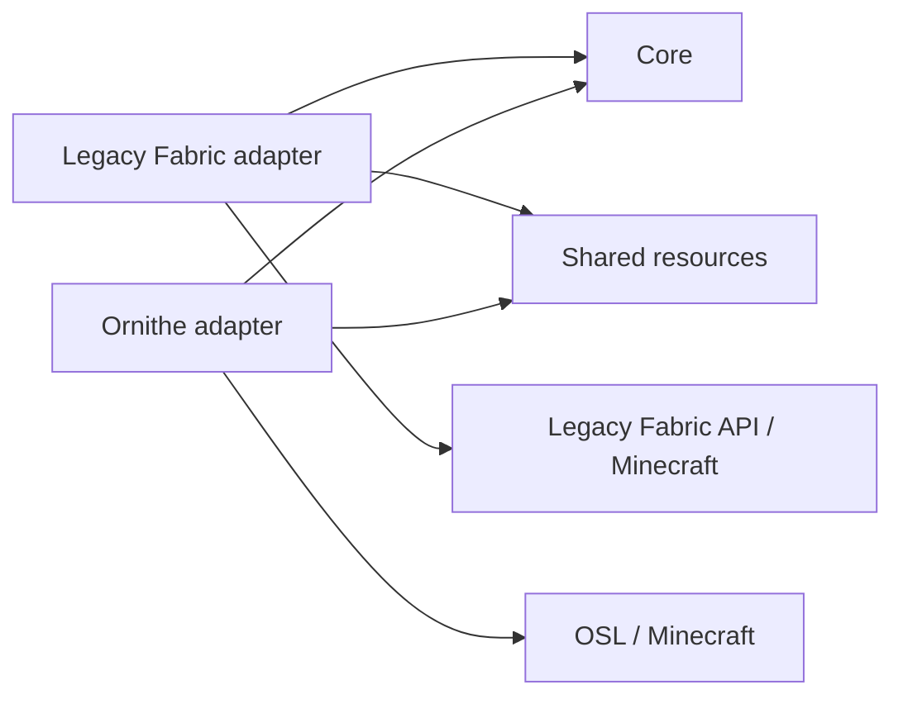

# Architecture

The build has four projects and a small included `build-logic` build. It produces two
independent client mods for Minecraft 1.8.9. The adapters use different mappings and
intermediary namespaces; each distribution contains the same core classes and assets.

## Architecture

The domain is visibility state. `VisibilityController` implements the toggle use case
and exposes a read-only `VisibilityView`. `ClientEffects` is the boundary for world
availability, translated feedback, and renderer invalidation. The adapters implement
that boundary with their respective Minecraft and platform APIs.

## Modules

| Project | Contents | Production dependencies |
| --- | --- | --- |
| `core` | Visibility controller and interfaces | Java standard library |
| `shared-resources` | Nine translations, icon, barrier models and texture | None |
| `legacy-fabric` | Client entrypoint, event/key adapter, three Mixins, metadata | Core, resources, Legacy Fabric API, Fabric Loader, Minecraft |
| `ornithe` | Client entrypoint, event/key adapter, three Mixins, metadata | Core, resources, OSL modules, Fabric Loader, Minecraft |

`shared-resources` exposes a resource archive through a consumable Gradle configuration.
Adapters consume it through project dependencies. Core classes are embedded directly
in each adapter JAR before remapping. Neither the core archive nor the resource archive
is installed separately. Each adapter exposes its `remapJar` output for distribution
verification and staging.

Build conventions configure Java 8 compilation, Java 8 tests, reproducible archive
ordering, and adapter packaging. Loader plugins apply only to adapter projects. The
root build aggregates checks and distributions; it contains no mod sources.

Committed daemon JVM criteria select JDK 21 for both command-line and IDE builds.
Each settings build configures toolchain provisioning, so the included build can resolve
its compiler independently and the main build can provision the Java 8 test runtime.

## Boundaries

Core production compilation and runtime classpaths contain no external dependencies.
It imports no Minecraft, Mixin, loader, or logging APIs. Tests may use JUnit. Artifact
verification also checks the core bytecode for non-JDK type references.

Mixins query the adapter's read-only visibility entrypoint. The block Mixin changes
the render type when visible and supplies translucent rendering and adjacent-face
handling. The particle Mixin suppresses barrier particles while visible. The model
Mixin enables the ordinary barrier block model. These hooks contain no input handling,
state transitions, or client lifecycle logic.

## Contracts

The controller is constructed on the client thread, which exclusively owns mutation
and client effects. `toggle()` rejects calls from another thread before touching the
client boundary. A volatile visibility field publishes changes to rendering workers.
State changes precede feedback and renderer invalidation.

Each adapter registers its callbacks once. Its safely published read-only view returns
hidden before initialization. The tick callback consumes every queued key press;
presses without both a world and a player are discarded. There is no pending action to
replay on the next connection.

Visibility survives disconnects, world changes, and resource reloads within a client
process. A new client process starts hidden. There is no persistent configuration or
server-side state.

Public guarantees and versioning policy are defined in [compatibility.md](compatibility.md).
The Java types are internal implementation interfaces, not a separately published API.
